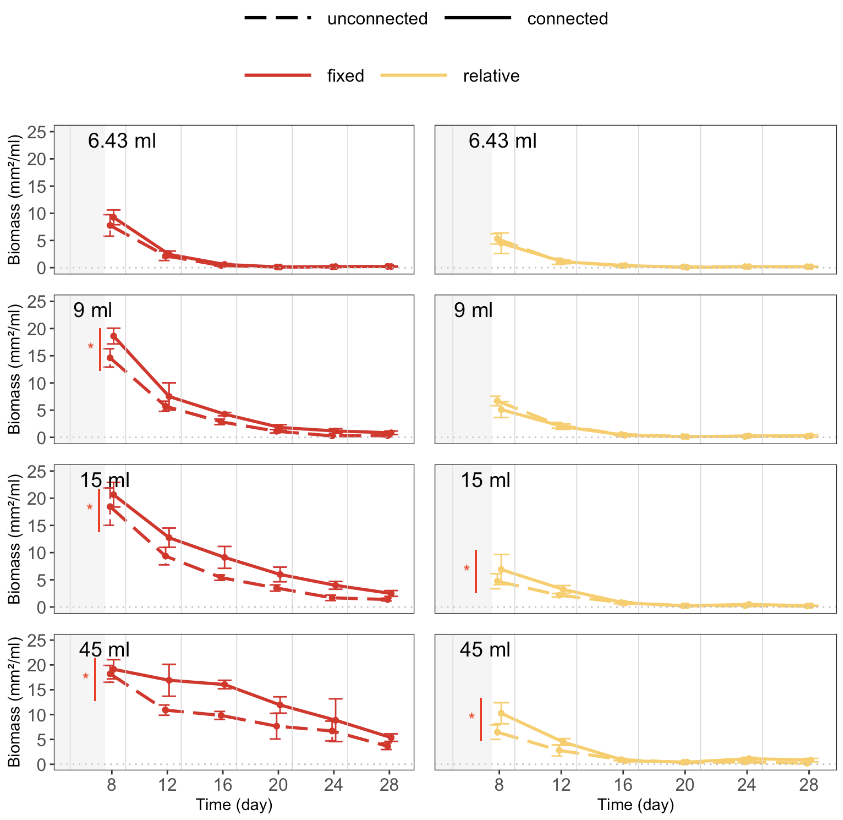

```{r define-parameters-metaecos-biomass}

# --- DEFINE PARAMETERS --- #

response_variable_selected = "bioarea_mm2_per_ml"
```

<details>
<summary>Plot original data</summary>
```{r plot-original-data-one-size-per-plot-metaeecos-biomass, fig.height = figures_height_rmd_output, fig.width = figures_width_rmd_output}

# --- PLOT ONE PLOT PER ECOSYSTEM SIZE --- #

plot.metaecos.sizes.one.by.one.means(ds_metaecosystems,
                                     response_variable_selected,
                                     y_upper_limit = 25)
```
</details>

<details>
<summary>Prepare & plot data for analysis</summary>
```{r prepare-data-for-analysis-metaecos}

# --- PREPARE DATA FOR ANALYSIS --- #

# Add baselines

baseline = ds_metaecosystems %>%
  filter(time_point == time_point_of_baselines) %>%
  select(metaecosystem_ID,
         all_of(response_variable_selected)) %>%
  rename(baseline = all_of(response_variable_selected))

data_for_analysis = ds_metaecosystems %>%
  left_join(baseline)

# Filter and mutate

data_for_analysis = data_for_analysis %>%
  filter(time_point %in% time_points_model,
         !is.na(!!sym(response_variable_selected)),
         connection == "connected" | 
          ecosystems_combined %in% unconnected_metaecosystems_selected) %>%
  mutate(conn = factor(x = ifelse(connection == "connected", 
                                  "con", 
                                  "unconnected"),
                       levels = c("unconnected", "con")))
```

```{r plot-data-for-analysis-metaecos, fig.height = figures_height_rmd_output, fig.width = figures_height_rmd_output}

# --- PLOT ONE PLOT PER ECOSYSTEM SIZE --- #

plot.metaecos.sizes.one.by.one.means(data_for_analysis,
                                     response_variable_selected,
                                     y_upper_limit = 25)
```
</details>

<details open = "open">
<summary>Figures with results</summary>

</details>

<details>
<summary>Create model</summary>
```{r create-model-metaecos}

# --- CREATE MODEL --- #

# Prepare data

data_for_analysis = data_for_analysis %>% 
  rename(size = ecosystem_size_ml,
         disturb_type = volume_disturbed_across_sizes) %>%
  mutate(size = as.factor(size),
         day = as.factor(day))

# Define formula

formula = as.formula(paste("bioarea_mm2_per_ml ~",
                           "size * conn * disturb_type +",
                           "(1 | metaecosystem_ID) +",
                           "(1 | time_point) +",
                           "(1 | baseline)")) %>%
  print()

# Create model 

model <- glmmTMB(formula,
                 family = Gamma(link = "log"), 
                 data = data_for_analysis)
```

```{r show-model-summary}

# --- SHOW MODEL SUMMARY --- #

print(summary(model), digits = 3)
```

```{r code-model-contrasts-metaecos}

# --- CODE MODEL CONSTRASTS --- #

# Estimate marginal means (least-squares means)

emmeans_output = emmeans(model,
                         specs = ~  conn * disturb_type * size,
                         adjust = "sidak",
                         bias.adj = TRUE,
                         lmer.df = "satterthwaite") 

emmeans_output

# Give a name for each level which you want to compare

uncon_fixed_6_43 = c(1, rep(0,15)) 
con_fixed_6_43 = c(rep(0,1), 1, rep(0,14)) 
uncon_relative_6_43 = c(rep(0,2), 1, rep(0,13)) 
con_relative_6_43 = c(rep(0,3), 1, rep(0,12)) 
uncon_fixed_9 = c(rep(0,4), 1, rep(0,11)) 
con_fixed_9 = c(rep(0,5), 1, rep(0,10)) 
uncon_relative_9 = c(rep(0,6), 1, rep(0,9)) 
con_relative_9 = c(rep(0,7), 1, rep(0,8)) 
uncon_fixed_15 = c(rep(0,8), 1, rep(0,7))
con_fixed_15 = c(rep(0,9), 1, rep(0,6))
uncon_relative_15 = c(rep(0,10), 1, rep(0,5))
con_relative_15 = c(rep(0,11), 1, rep(0,4))
uncon_fixed_45 = c(rep(0,12), 1, rep(0,3))
con_fixed_45 = c(rep(0,13), 1, rep(0,2))
uncon_relative_45 = c(rep(0,14), 1, rep(0,1))
con_relative_45 = c(rep(0,15), 1)

# Compute the contrasts

n_of_digits = 3
contrasts = contrast(emmeans_output, 
                     method = list("6.43 ml fixed" = con_fixed_6_43 - uncon_fixed_6_43,
                                   "9.00 ml fixed" = con_fixed_9 - uncon_fixed_9,
                                   "15.00 ml fixed" = con_fixed_15 - uncon_fixed_15,
                                   "45.00 ml fixed" = con_fixed_45 - uncon_fixed_45,
                                   "6.43 ml relative" = con_relative_6_43 - uncon_relative_6_43,
                                   "9.00 ml relative" = con_relative_9 - uncon_relative_9,
                                   "15.00 ml relative" = con_relative_15 - uncon_relative_15,
                                   "45.00 ml relative" = con_relative_45 - uncon_relative_45)) %>% 
  as.data.frame() %>%
  mutate(p.value = round(p.value, digits = n_of_digits),
         estimate = round(estimate, digits = n_of_digits),
         SE = round(SE, digits = n_of_digits),
         df = round(df, digits = n_of_digits),
         z.ratio = round(z.ratio, digits = n_of_digits),
         e = "",
         e = ifelse(p.value > 0.1, 
                           "",
                           e),
         e = ifelse(p.value < 0.05, 
                           "*",
                           e),
         e = ifelse(p.value < 0.01, 
                           "**",
                           e),
         e = ifelse(p.value < 0.001, 
                           "***",
                           e)) %>%
  rename(" " = e)
```
</details>

<details open="open">
<summary>Model ANOVA</summary>
```{r show-model-anova}

# --- SHOW MODEL ANOVA --- #

car::Anova(model, type = "III")
```
</details>

<details open = "open">
<summary>Model contrasts</summary>
```{r show-model-contrasts}

# --- SHOW MODEL CONTRASTS --- #

contrasts
```
</details>

<details open="open">
<summary>Model residuals</summary>
```{r plot-model-residuals-metaecos, fig.width = figures_height_rmd_output}

# --- PLOT MODEL RESIDUALS --- #

# Simulate residuals from the fitted model

simulationOutput <- simulateResiduals(fittedModel = model, 
                                      n = 1000) 

# Test for overdispersion in the model to check if variance exceeds mean

testDispersion(simulationOutput)

# Plot Q-Q and Residuals vs Fitted plots

plot(simulationOutput)

# Plot residuals against specific predictors to check if residuals are 
# independent of these variables - fixed variables

plotResiduals(simulationOutput,
              form = data_for_analysis$size)
plotResiduals(simulationOutput,
              form = data_for_analysis$conn)
plotResiduals(simulationOutput,
              form = data_for_analysis$disturb_type)

# Plot residuals against specific predictors to check if residuals are 
# independent of these variables - random variables

plotResiduals(simulationOutput,
              form = data_for_analysis$metaecosystem_ID)
plotResiduals(simulationOutput,
              form = data_for_analysis$time_point)
plotResiduals(simulationOutput,
              form = data_for_analysis$baseline)

# Test for outliers 

testOutliers(simulationOutput)

# Test for zero inflation not accounted for
 
testZeroInflation(simulationOutput)
```
</details>