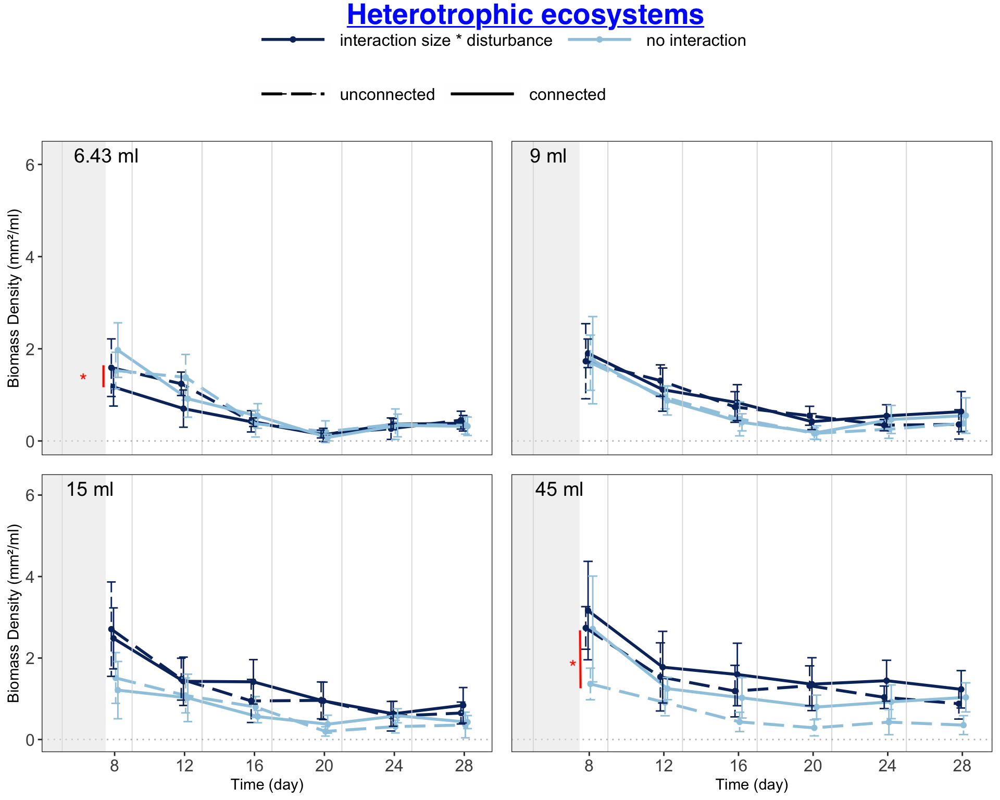
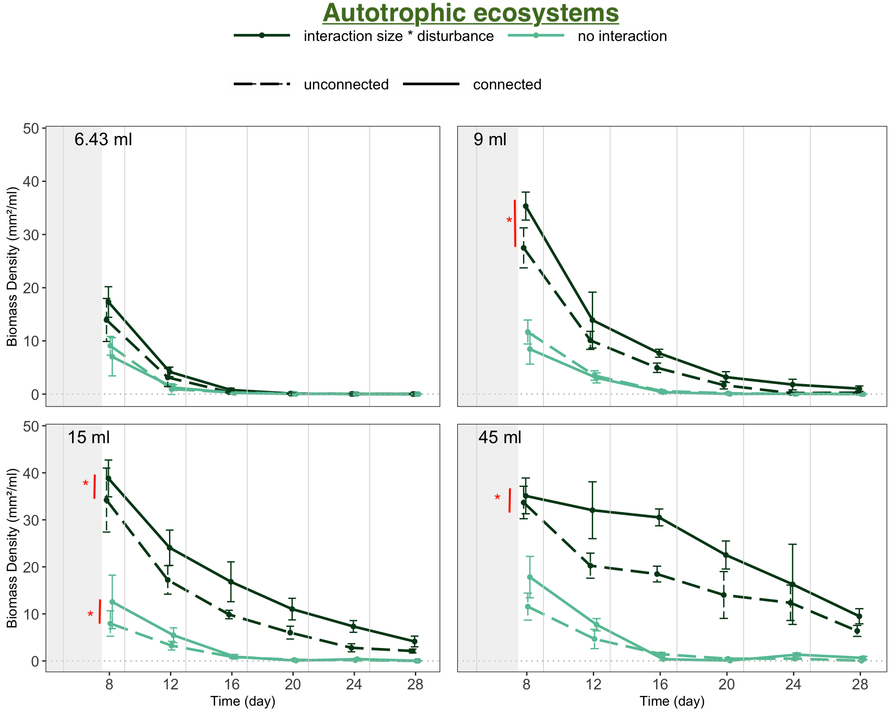

```{r define-parameters-eco-biomass}

# --- DEFINE PARAMETERS --- #

response_variable_selected = "bioarea_mm2_per_ml"
```

<details>
<summary>Plot original data</summary>
```{r plot-original-data-one-size-per-plot-ecos-biomass, fig.height = figures_height_rmd_output, fig.width = figures_width_rmd_output}

# --- PLOT ONE PLOT PER ECOSYSTEM SIZE --- #

# Plot heterotrophic ecosystems

print("Heterotrophic ecosystems")
plot.ecos.sizes.one.by.one.means(ds_ecosystems,
                                 "heterotrophic",
                                 response_variable_selected,
                                 light_colour_hetero,
                                 dark_colour_hetero,
                                 y_upper_limit = 6.2)

# Plot autotrophic ecosystems

print("Autotrophic ecosystems")
plot.ecos.sizes.one.by.one.means(ds_ecosystems,
                                 "autotrophic",
                                 response_variable_selected,
                                 light_colour_auto,
                                 dark_colour_auto,
                                 y_upper_limit = 48)
```
</details>

<details>
<summary>Prepare & plot data for analysis</summary>
```{r prepared-data-for-analysis-ecos-biomass}

# --- PREPARE DATA FOR ANALYSIS --- #

# Add baselines

baseline = ds_ecosystems %>%
  filter(time_point == time_point_of_baselines) %>%
  select(ecosystem_ID,
         all_of(response_variable_selected)) %>%
  rename(baseline = all_of(response_variable_selected))

data_for_analysis = ds_ecosystems %>%
  left_join(baseline)

# Filter and mutate

data_for_analysis = data_for_analysis %>%
  filter(time_point %in% time_points_model,
         !is.na(!!sym(response_variable_selected))) %>%
  mutate(trophic_type = as.factor(trophic_type),
         size = as.factor(ecosystem_size_ml),
         conn = factor(x = ifelse(connection == "connected", 
                                  "con", 
                                  "unconnected"),
                       levels = c("unconnected", "con")),
         disturbance_percentage = as.factor(disturbance_percentage),
         day = as.double(day),
         ecosystem_ID = as.factor(ecosystem_ID))
```

```{r plot-data-for-analysis-one-size-per-plot-ecos-biomass, fig.height = figures_height_rmd_output, fig.width = figures_width_rmd_output}

# --- PLOT ONE PLOT PER ECOSYSTEM SIZE --- #

# Plot heterotrophic ecosystems

print("Heterotrophic ecosystems")
plot.ecos.sizes.one.by.one.means(data_for_analysis,
                                 "heterotrophic",
                                 response_variable_selected,
                                 light_colour_hetero,
                                 dark_colour_hetero,
                                 y_upper_limit = 6.2)

# Plot autotrophic ecosystems

print("Autotrophic ecosystems")
plot.ecos.sizes.one.by.one.means(data_for_analysis,
                                 "autotrophic",
                                 response_variable_selected,
                                 light_colour_auto,
                                 dark_colour_auto,
                                 y_upper_limit = 48)
```
</details>

<details>
<summary>Plot data with significance level</summary>


</details>


<details>
<summary>Create model</summary>
```{r create-model-ecos-biomass}

# --- CREATE MODEL --- #

# Prepare data

data_for_analysis = data_for_analysis %>% 
  rename(dis_per = disturbance_percentage)

# Create formula

formula = as.formula(paste("bioarea_mm2_per_ml ~",
                           "trophic_type * size * conn * dis_per +",
                           "(1 | ecosystem_ID) +",
                           "(1 | day) +",
                           "(1 | baseline)")) %>%
  print()

# Model

model <- glmmTMB(formula,
                 data = data_for_analysis,
                 family = tweedie(link = "log"),
                 dispformula = ~ day + trophic_type + dis_per)
```

```{r show-model-summary-ecos-biomass}

# --- SHOW MODEL SUMMARY --- #

print(summary(model), digits = 3)
```

```{r code-model-contrasts-ecos-biomass}

# --- CODE MODEL CONSTRASTS --- #

# Estimate marginal means (Least-squares means)

emmeans_output = emmeans(model,
                         specs = ~  conn * dis_per * size * trophic_type,  # Calculate emmeans for the interaction of conn, dis_per, size, and trophic_type
                         adjust = "sidak",  # Use Sidak adjustment for multiple comparisons
                         bias.adj = TRUE,  # Apply bias adjustment
                         lmer.df = "satterthwaite")  # Use Satterthwaite approximation for degrees of freedom

emmeans_output

# Define contrast vectors for each group

aut_uncon_decr_6_43 = c(1, rep(0,31))  # Autotrophic, unconnected, 6.43 ml decrease
aut_con_decr_6_43 = c(rep(0,1), 1, rep(0,30))  # Autotrophic, connected, 6.43 ml decrease
aut_uncon_fix_6_43 = c(rep(0,2), 1, rep(0,29))  # Autotrophic, unconnected, 6.43 ml fixed
aut_con_fix_6_43 = c(rep(0,3), 1, rep(0,28))  # Autotrophic, connected, 6.43 ml fixed
aut_uncon_decr_9 = c(rep(0,4), 1, rep(0,27))  # Autotrophic, unconnected, 9.00 ml decrease
aut_con_decr_9 = c(rep(0,5), 1, rep(0,26))  # Autotrophic, connected, 9.00 ml decrease
aut_uncon_fix_9 = c(rep(0,6), 1, rep(0,25))  # Autotrophic, unconnected, 9.00 ml fixed
aut_con_fix_9 = c(rep(0,7), 1, rep(0,24))  # Autotrophic, connected, 9.00 ml fixed
aut_uncon_decr_15 = c(rep(0,8), 1, rep(0,23))  # Autotrophic, unconnected, 15.00 ml decrease
aut_con_decr_15 = c(rep(0,9), 1, rep(0,22))  # Autotrophic, connected, 15.00 ml decrease
aut_uncon_fix_15 = c(rep(0,10), 1, rep(0,21))  # Autotrophic, unconnected, 15.00 ml fixed
aut_con_fix_15 = c(rep(0,11), 1, rep(0,20))  # Autotrophic, connected, 15.00 ml fixed
aut_uncon_decr_45 = c(rep(0,12), 1, rep(0,19))  # Autotrophic, unconnected, 45.00 ml decrease
aut_con_decr_45 = c(rep(0,13), 1, rep(0,18))  # Autotrophic, connected, 45.00 ml decrease
aut_uncon_fix_45 = c(rep(0,14), 1, rep(0,17))  # Autotrophic, unconnected, 45.00 ml fixed
aut_con_fix_45 = c(rep(0,15), 1, rep(0,16))  # Autotrophic, connected, 45.00 ml fixed

# Same pattern for heterotrophic group

het_uncon_decr_6_43 = c(rep(0,16), 1, rep(0,15))  # Heterotrophic, unconnected, 6.43 ml decrease
het_con_decr_6_43 = c(rep(0,17), 1, rep(0,14))  # Heterotrophic, connected, 6.43 ml decrease
het_uncon_fix_6_43 = c(rep(0,18), 1, rep(0,13))  # Heterotrophic, unconnected, 6.43 ml fixed
het_con_fix_6_43 = c(rep(0,19), 1, rep(0,12))  # Heterotrophic, connected, 6.43 ml fixed
het_uncon_decr_9 = c(rep(0,20), 1, rep(0,11))  # Heterotrophic, unconnected, 9.00 ml decrease
het_con_decr_9 = c(rep(0,21), 1, rep(0,10))  # Heterotrophic, connected, 9.00 ml decrease
het_uncon_fix_9 = c(rep(0,22), 1, rep(0,9))  # Heterotrophic, unconnected, 9.00 ml fixed
het_con_fix_9 = c(rep(0,23), 1, rep(0,8))  # Heterotrophic, connected, 9.00 ml fixed
het_uncon_decr_15 = c(rep(0,24), 1, rep(0,7))  # Heterotrophic, unconnected, 15.00 ml decrease
het_con_decr_15 = c(rep(0,25), 1, rep(0,6))  # Heterotrophic, connected, 15.00 ml decrease
het_uncon_fix_15 = c(rep(0,26), 1, rep(0,5))  # Heterotrophic, unconnected, 15.00 ml fixed
het_con_fix_15 = c(rep(0,27), 1, rep(0,4))  # Heterotrophic, connected, 15.00 ml fixed
het_uncon_decr_45 = c(rep(0,28), 1, rep(0,3))  # Heterotrophic, unconnected, 45.00 ml decrease
het_con_decr_45 = c(rep(0,29), 1, rep(0,2))  # Heterotrophic, connected, 45.00 ml decrease
het_uncon_fix_45 = c(rep(0,30), 1, rep(0,1))  # Heterotrophic, unconnected, 45.00 ml fixed
het_con_fix_45 = c(rep(0,31), 1)  # Heterotrophic, connected, 45.00 ml fixed

n_of_digits = 3  # Set number of digits for rounding

# Calculate contrasts using the defined vectors

contrasts = contrast(emmeans_output, 
                     method = list("Het 6.43 ml no interact" = het_con_fix_6_43 - het_uncon_fix_6_43,  
                                   "Het 6.43 ml with interact" = het_con_decr_6_43 - het_uncon_decr_6_43,
                                   "Het 9.00 ml no interact" = het_con_fix_9 - het_uncon_fix_9,  
                                   "Het 9.00 ml with interact" = het_con_decr_9 - het_uncon_decr_9,  
                                   "Het 15.00 ml no interact" = het_con_fix_15 - het_uncon_fix_15,  
                                   "Het 15.00 ml with interact" = het_con_decr_15 - het_uncon_decr_15, 
                                   "Het 45.00 ml no interact" = het_con_fix_45 - het_uncon_fix_45,
                                   "Het 45.00 ml with interact" = het_con_decr_45 - het_uncon_decr_45, 
                                   "Aut 6.43 ml no interact" = aut_con_fix_6_43 - aut_uncon_fix_6_43,  
                                   "Aut 6.43 ml with interact" = aut_con_decr_6_43 - aut_uncon_decr_6_43,
                                   "Aut 9.00 ml no interact" = aut_con_fix_9 - aut_uncon_fix_9,  
                                   "Aut 9.00 ml with interact" = aut_con_decr_9 - aut_uncon_decr_9,  
                                   "Aut 15.00 ml no interact" = aut_con_fix_15 - aut_uncon_fix_15,
                                   "Aut 15.00 ml with interact" = aut_con_decr_15 - aut_uncon_decr_15,
                                   "Aut 45.00 ml no interact" = aut_con_fix_45 - aut_uncon_fix_45,
                                   "Aut 45.00 ml with interact" = aut_con_decr_45 - aut_uncon_decr_45)) %>% 
  as.data.frame() %>%  # Convert the contrast output to a data frame
  mutate(p.value = round(p.value, digits = n_of_digits),  # Round p-value to specified digits
         estimate = round(estimate, digits = n_of_digits),  # Round estimate
         SE = round(SE, digits = n_of_digits),  # Round standard error
         df = round(df, digits = n_of_digits),  # Round degrees of freedom
         z.ratio = round(z.ratio, digits = n_of_digits),  # Round t-ratio (z.ratio)
         e = "",  # Initialize a column for significance indicators
         e = ifelse(p.value > 0.1, 
                           "",  # No symbol if p-value > 0.1
                           e),
         e = ifelse(p.value < 0.05, 
                           "*",  # Add * if p-value < 0.05
                           e),
         e = ifelse(p.value < 0.01, 
                           "**",  # Add ** if p-value < 0.01
                           e),
         e = ifelse(p.value < 0.001, 
                           "***",  # Add *** if p-value < 0.001
                           e)) %>%
  rename(" " = e)  # Rename column to show significance markers

```
</details>

<details open="open">
<summary>Model ANOVA</summary>
```{r show-model-anova-ecos-biomass}

# --- SHOW MODEL ANOVA --- #

car::Anova(model, type = "III") 
```
</details>

<details open="open">
<summary>Model contrasts</summary>
```{r show-model-contrasts-ecos-biomass}

# --- SHOW MODEL CONTRASTS --- #

contrasts
```
</details>


<details open="open">
<summary>Model residuals</summary>
```{r plot-model-residuals-ecos-biomass, fig.width = figures_height_rmd_output}

# --- PLOT MODEL RESIDUALS --- #

# Simulate residuals from the fitted model

simulationOutput <- simulateResiduals(fittedModel = model, 
                                      n = 1000) 

# Test for overdispersion in the model to check if variance exceeds mean

testDispersion(simulationOutput)

# Plot Q-Q and Residuals vs Fitted plots

plot(simulationOutput)

# Plot residuals against specific predictors to check if residuals are 
# independent of these variables - fixed variables

plotResiduals(simulationOutput,
              form = data_for_analysis$size)
plotResiduals(simulationOutput,
              form = data_for_analysis$conn)
plotResiduals(simulationOutput,
              form = data_for_analysis$dis_per)

# Plot residuals against specific predictors to check if residuals are 
# independent of these variables - random variables

plotResiduals(simulationOutput,
              form = data_for_analysis$system_nr)
plotResiduals(simulationOutput,
              form = data_for_analysis$time_point)
plotResiduals(simulationOutput,
              form = data_for_analysis$baseline)

# Test for outliers 

testOutliers(simulationOutput)

# Test for zero inflation not accounted for

testZeroInflation(simulationOutput)
```
</details>