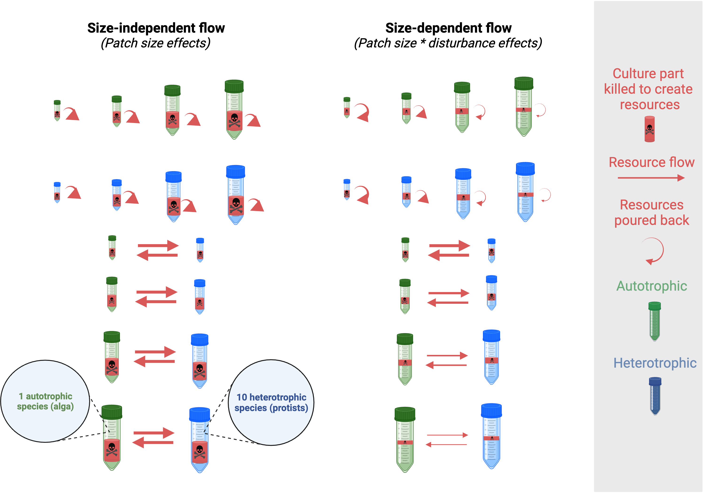

#  {.tabset}

```{r echo=FALSE, message=FALSE}
library("here")
```

```{r child = here("r_files", "packages.Rmd"), echo=FALSE}
```

```{r child = here("r_files", "functions.Rmd"), echo=FALSE}
```

## Design



## Parameters {.tabset .tabset-dropdown}

```{r child = here("r_files", "parameters.Rmd"), class.source = 'fold-show'}
```

## Data {.tabset .tabset-dropdown}

```{r echo = FALSE}
culture_info = read.csv(here("data", "RelativeSize_culture_info.csv"), header = TRUE)
```

```{r child = here("r_files", "ds_individuals.Rmd")}
```

```{r child = here("r_files", "ds_patches.Rmd")}
```

```{r child = here("r_files", "ds_patches_effect_size.Rmd")}
```

### Meta-ecosystems (`ds_metaecosystems`)

In this dataset (`ds_metaecosystems`) each row represents a meta-ecosystem or a two-patch isolated system at a time point.

```{r child = here("r_files", "combinations_patches.Rmd")}
```

```{r child = here("r_files", "combinations_patches_sets.Rmd")}
```

```{r child = here("r_files", "ds_metaecosystems.Rmd")}
```

### Meta-ecosystems effect sizes (`ds_metaecos_es`)

```{r child = here("r_files", "ds_metaecosystems_effect_size.Rmd"), eval = FALSE}
```

## Plots & analysis (s) {.tabset .tabset-dropdown}

### Meta-ecosystems {.tabset .tabset-pills}

```{r}
metaecosystem_analysis = TRUE; patch_analysis = TRUE
blue_patches = FALSE
metaecosystem_type_i = c(
  "Small meta-ecosystem (s)",
  "Small two-patch isolated (s)",
  "Small-Medium meta-ecosystem (s)",
  "Small-Medium two-patch isolated (s)",
  "Medium-Large meta-ecosystem (s)",
  "Medium-Large two-patch isolated (s)",
  "Large meta-ecosystem (s)",
  "Large two-patch isolated (s)"
)
metaecosystem_type_input_analysis = metaecosystem_type_i
```

```{r child = here("r_files", "metaecosystems.Rmd")}
```

### Blue patches {.tabset .tabset-pills}

```{r}
patch_analysis = FALSE; metaecosystem_analysis = TRUE
blue_patches = TRUE
patch_type_i = c("Blue small isolated (s)",
                 "Blue small-medium isolated (s)",
                 "Blue medium-large isolated (s)",
                 "Blue large isolated (s)",
                 "Blue small connected (s)",
                 "Blue small-medium connected (s)",
                 "Blue medium-large connected (s)",
                 "Blue large connected (s)")
patch_type_input_analysis = patch_type_i
```

```{r child = here("r_files", "patches.Rmd")}
```

### Green patches {.tabset .tabset-pills}

```{r}
blue_patches = FALSE
patch_type_i = c("Green small isolated (s)",
                 "Green small-medium isolated (s)",
                 "Green medium-large isolated (s)",
                 "Green large isolated (s)",
                 "Green small connected (s)",
                 "Green small-medium connected (s)",
                 "Green medium-large connected (s)",
                 "Green large connected (s)")
patch_type_input_analysis = patch_type_i
```

```{r child = here("r_files", "patches.Rmd")}
```

## Plots & analysis (s \* d) {.tabset .tabset-dropdown}

### Meta-ecosystems {.tabset .tabset-pills}

```{r}
metaecosystem_analysis = TRUE; patch_analysis = TRUE
blue_patches = FALSE
metaecosystem_type_i = c(
  "Small meta-ecosystem (s*d)",
  "Small two-patch isolated (s*d)",
  "Small-Medium meta-ecosystem (s*d)",
  "Small-Medium two-patch isolated (s*d)",
  "Medium-Large meta-ecosystem (s*d)",
  "Medium-Large two-patch isolated (s*d)",
  "Large meta-ecosystem (s*d)",
  "Large two-patch isolated (s*d)"
)
metaecosystem_type_input_analysis = metaecosystem_type_i
```

```{r child = here("r_files", "metaecosystems.Rmd")}
```

### Blue patches {.tabset .tabset-pills}

```{r}
patch_analysis = FALSE; metaecosystem_analysis = TRUE
blue_patches = TRUE
patch_type_i = c("Blue small isolated (s*d)",
                 "Blue small-medium isolated (s*d)",
                 "Blue medium-large isolated (s*d)",
                 "Blue large isolated (s*d)",
                 "Blue small connected (s*d)",
                 "Blue small-medium connected (s*d)",
                 "Blue medium-large connected (s*d)",
                 "Blue large connected (s*d)")
patch_type_input_analysis = patch_type_i
```

```{r child = here("r_files", "patches.Rmd")}
```

### Green patches {.tabset .tabset-pills}

```{r}
blue_patches = FALSE
patch_type_i = c("Green small isolated (s*d)",
                 "Green small-medium isolated (s*d)",
                 "Green medium-large isolated (s*d)",
                 "Green large isolated (s*d)",
                 "Green small connected (s*d)",
                 "Green small-medium connected (s*d)",
                 "Green medium-large connected (s*d)",
                 "Green large connected (s*d)")
patch_type_input_analysis = patch_type_i
```

```{r child = here("r_files", "patches.Rmd")}
```

## Other

Save files to calculate the effect size of meta-ecosystems. 

```{r}
write.csv(combination_sets_isolated_systems,
          file = here("files_for_ds_metaecos_es", "combination_sets_isolated_systems.csv"))

write.csv(ds_metaecosystems,
          file = here("files_for_ds_metaecos_es", "ds_metaecosystems.csv"))

write.csv(ds_metaecosystems,
          file = here("files_for_ds_metaecos_es", "ds_metaecosystems.csv"))
```

## Bibliography

```{r echo=FALSE, message=FALSE}
#Save environment
save.image(file = here("environments", "end.RData"))
```
