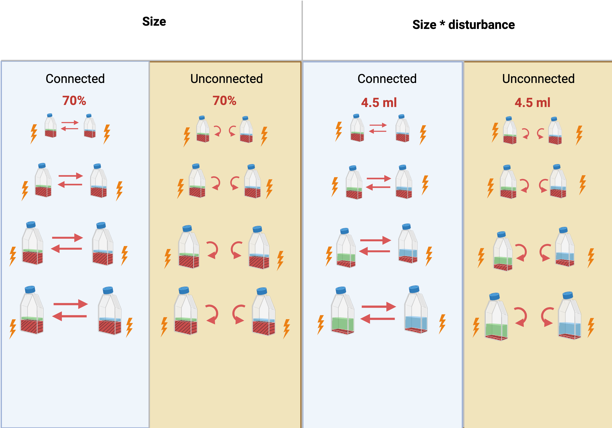

#  {.tabset}

```{r echo=FALSE, message=FALSE}
library("here")
```

```{r child = here("2_r_files", "set_packages.Rmd"), echo=FALSE}
```

```{r child = here("2_r_files", "set_functions.Rmd"), echo=FALSE}
```

## Design



## Parameters {.tabset .tabset-dropdown}

```{r child = here("2_r_files", "set_parameters.Rmd"), class.source = 'fold-show'}
```

## Data {.tabset .tabset-dropdown}

### Ecosystems (`ds_ecosystems`) {.tabset .tabset-pills}

To analyse the biomass, biodiversity, and population densities within ecosystems in our experiment, we require a dataset where each row represents an ecosystem at a specific time point (ds_ecosystems). However, species data needs to be integrated, as it is derived from the results of two analyses conducted on the same videos using two imageJ lower thresholds (referred to as threshold hereafter) to distinguish between foreground and background intensity (the lower this threshold, the more it tracks smaller particles.) Initially, we analysed the videos with BEMOVI setting a threshold of 13. Then, because this threshold didn’t cut out Chi in the monocultures of Ble, we analysed the videos again with a threshold of 40 (with threshold 40 Cep and Spi had lower identification error, hence we kept this threshold for their identification too). Therefore, we need to integrate the results of threshold 13 and 40 into the ultimate dataset (ds_ecosystems). We combine the following information from the two analyses. Total biomass and species data of Col, Eug, Eup, Lox, Pau, Pca, Spi te, and Tet from the analysis with threshold 13 and species data of Ble, Cep, Spi from the analysis with threshold 40. For each of the threshold levels we produce an ecosystem dataset (ds_ecosystems[[13]] or ds_ecosystems[[40]]) by compiling for that threshold level information on every individual organism detected (ds_individuals), identify these individuals, and aggregate their data to derive ecosystem-level information. Individuals data already has been filtered out from particles that are too slow (filter_min_net_disp), don't move for enough time (filter_min_duration), are not detected for an enough number of frames (filter_detection_freq), or ... (filter_median_step_length) to be protists. 

<br>

#### Threshold 13

```{r}
threshold = 13
```

```{r child = here("2_r_files", "create_ds_ecos_1_single_threshold_individuals.Rmd"), class.source = 'fold-show'}
```

```{r child = here("2_r_files", "create_ds_ecos_2_single_threshold_species_ID.Rmd"), class.source = 'fold-show'}
```

```{r child = here("2_r_files", "create_ds_ecos_3_single_threshold_ecosystems.Rmd"), class.source = 'fold-show'}
```

<br>

#### Threshold 40

```{r}
threshold = 40
```

```{r child = here("2_r_files", "create_ds_ecos_1_single_threshold_individuals.Rmd"), class.source = 'fold-show'}
```

```{r child = here("2_r_files", "create_ds_ecos_2_single_threshold_species_ID.Rmd"), class.source = 'fold-show'}
```

```{r child = here("2_r_files", "create_ds_ecos_3_single_threshold_ecosystems.Rmd"), class.source = 'fold-show'}
```

#### Combine thresholds

```{r child = here("2_r_files", "create_ds_ecos_4_both_thresholds_combined.Rmd"), class.source = 'fold-show'}
```

### Species dominances with CI (`ds_dominances_with_CI`)

```{r child = here("2_r_files", "create_ds_dominances_with_CI.Rmd"), class.source = 'fold-show'}
```

### Ecosystems effect sizes (`ds_ecosystems_effect_size`)

```{r child = here("2_r_files", "create_ds_ecos_effect_size.Rmd"), class.source = 'fold-show'}
```

### Species effect sizes d (`ds_species_effect_sizes_d`)

```{r child = here("2_r_files", "create_ds_species_effect_sizes_d.Rmd"), class.source = 'fold-show'}
```

### Species effect sizes LRR (`ds_species_effect_sizes_LRR`)

```{r child = here("2_r_files", "create_ds_species_effect_sizes_LRR.Rmd"), class.source = 'fold-show'}
```

### Meta-ecosystems (`ds_metaecosystems`)

```{r echo=FALSE, message=FALSE}
#Save environment
save.image(file = here("3_results", "before.RData"))
```

```{r child = here("2_r_files", "create_ds_metaecosystems.Rmd"), class.source = 'fold-show'}
```

### Meta-ecosystems effect sizes (`ds_metaecos_es`)

```{r child = here("2_r_files", "create_ds_metaecosystems_effect_size.Rmd"), class.source = 'fold-show'}
```

## Plots & analysis {.tabset .tabset-dropdown}

### Meta-ecosystems {.tabset .tabset-pills}

```{r}
response_variable = "total_metaecosystem_bioarea_mm2"
```

```{r echo=FALSE, message=FALSE}
#Save environment
save.image(file = here("3_results", "before2.RData"))
```

```{r child = here("2_r_files", "analyse_metaecosystems_1_plot.Rmd")}
```

```{r child = here("2_r_files", "analyse_metaecosystems_2_untransformed.Rmd")}
```

```{r child = here("2_r_files", "analyse_metaecosystems_3_untransformed_only_s.Rmd")}
```

```{r child = here("2_r_files", "analyse_metaecosystems_4_ES.Rmd")}
```

```{r child = here("2_r_files", "analyse_metaecosystems_5_ES_only_s.Rmd"), eval = FALSE}
```

### Autotrophic ecosystems {.tabset .tabset-pills}

```{r}
trophy_selected = "autotrophic"
```

#### Biomass {.tabset .tabset-dropdown}

```{r}
response_variable = "bioarea_mm2_per_ml"
```

```{r child = here("2_r_files", "analyse_ecosystems_1_plot.Rmd")}
```

```{r child = here("2_r_files", "analyse_ecosystems_2_untransformed.Rmd")}
```

### Heterotrophic ecosystems {.tabset .tabset-pills}

```{r}
trophy_selected = "heterotrophic"
```

#### Biomass {.tabset .tabset-dropdown}

```{r}
response_variable = "bioarea_mm2_per_ml"
```

```{r child = here("2_r_files", "analyse_ecosystems_1_plot.Rmd")}
```

```{r child = here("2_r_files", "analyse_ecosystems_2_untransformed.Rmd")}
```

#### Shannon {.tabset .tabset-dropdown}

```{r}
response_variable = "shannon"
```

```{r child = here("2_r_files", "analyse_ecosystems_1_plot.Rmd")}
```

```{r child = here("2_r_files", "analyse_ecosystems_2_untransformed.Rmd")}
```

#### Evenness {.tabset .tabset-dropdown}

```{r}
response_variable = "evenness_pielou"
```

```{r child = here("2_r_files", "analyse_ecosystems_1_plot.Rmd")}
```

```{r child = here("2_r_files", "analyse_ecosystems_2_untransformed.Rmd")}
```

#### Dominance {.tabset .tabset-pills}

##### Fixed disturbance {.tabset .tabset-pills}

```{r}
size_effects_selected = "(fixed)"
```

###### S

```{r}
eco_type = "S-H"
```

```{r child = here("2_r_files", "analyse_ecosystems_dominance.Rmd")}
```

###### SM

```{r}
eco_type = "SM-H"
```

```{r child = here("2_r_files", "analyse_ecosystems_dominance.Rmd")}
```

###### ML

```{r}
eco_type = "ML-H"
```

```{r child = here("2_r_files", "analyse_ecosystems_dominance.Rmd")}
```

###### L

```{r}
eco_type = "L-H"
```

```{r child = here("2_r_files", "analyse_ecosystems_dominance.Rmd")}
```

##### Disturbance relative to size {.tabset .tabset-pills}

```{r}
size_effects_selected = "(relative)"
```

###### S

```{r}
eco_type = "S-H"
```

```{r child = here("2_r_files", "analyse_ecosystems_dominance.Rmd")}
```

###### SM

```{r}
eco_type = "SM-H"
```

```{r child = here("2_r_files", "analyse_ecosystems_dominance.Rmd")}
```

###### ML

```{r}
eco_type = "ML-H"
```

```{r child = here("2_r_files", "analyse_ecosystems_dominance.Rmd")}
```

###### L

```{r}
eco_type = "L-H"
```

```{r child = here("2_r_files", "analyse_ecosystems_dominance.Rmd")}
```

#### BEF

```{r child = here("2_r_files", "analyse_ecosystems_BEF.Rmd")}
```

## Paper

```{r child = here("2_r_files", "show_paper.Rmd")}
```

## To do

- LRR for meta-ecosystems

## Other

```{r child = here("2_r_files", "show_other.Rmd")}
```

## Bibliography

```{r echo=FALSE, message=FALSE}
#Save environment
save.image(file = here("3_results", "end.RData"))
```